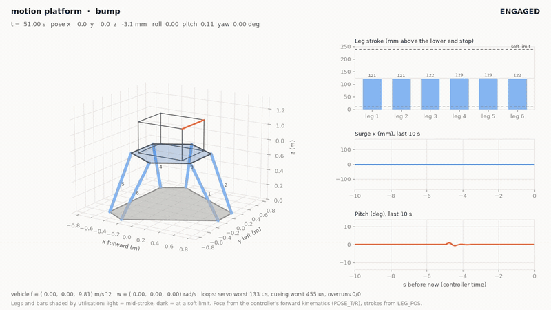

# 6-DOF motion platform controller

[](https://github.com/chad416/motion-platform-controller/actions/workflows/ci.yml)

Embedded controller for a 6-DOF electric motion platform (a Stewart platform) of the kind under vehicle and crew simulators. Vehicle motion comes in over CAN; a classical washout turns it into platform motion, the workspace limiter scales out-of-reach poses back as a whole, inverse kinematics gives six leg lengths, and six 1 kHz servo loops drive ball-screw actuator models. A safety state machine handles engage, park, E-stop, communication loss and actuator faults. It is C for Zephyr on an emulated STM32H753 in Renode, with the control code in a portable library (`mcue`) that the unit tests and the Python reference checks run unchanged. It is the motion base of a simulated small-arms and vehicle training lane, next to [trainer-weapon-firmware-twin](https://github.com/chad416/trainer-weapon-firmware-twin) and [aim-point-tracker](https://github.com/chad416/aim-point-tracker). Requirements and design: [SPEC.md](SPEC.md).



*17 s of the recorded host session: the 3 g cue, then braking with an E-stop and the descent to park. The whole 72 s session is [docs/media/platform_view.mp4](docs/media/platform_view.mp4) (use Raw to download it).*

**[Live demo](https://chad416.github.io/motion-platform-controller/):** the controller core (`mcue/`, the same C) compiled to WebAssembly, with six simulated actuators, in the browser. Drive with the arrow keys or pick a manoeuvre, press the E-stop or cut the host link, and watch the platform, the cue the rider feels and the leg strokes against their limits. Built and smoke-tested in CI (`.github/workflows/pages.yml`, `scripts/build-web.sh`).

## Key results

| Check | Result | Source |
|---|---|---|
| Unit tests (ztest on `native_sim`) | 72 of 72 pass; `mcue` line coverage 96.3 %, every function | `scripts/test-unit.sh`, CI gate ≥ 90 % |
| Renode integration tests over CAN | IT01–IT10 pass | `tests/robot/motion.robot`, [traceability](docs/traceability.md) |
| Ten minutes of cueing, all seven scenarios (IT09) | 0 overruns in 604 523 servo and 302 261 cueing cycles; worst 138 µs of 1000 and 600 µs of 2000; 0 of 60 410 vehicle samples dropped or stale; no STATUS gap | IT09 |
| Leg soft limits under a 3 g cue (P03) | never passed: strokes 10.09–239.91 mm of 10–240 mm, workspace scale down to 0.405 | IT05; property test, 10 000 random commands |
| Tilt-coordination rate (P04) | 3.000°/s in the five scenarios that stay inside the workspace; up to 29.8°/s under the 3 g cue, where the workspace scale changes (**partial**, SPEC §6.3a) | [results/closed_loop.md](results/closed_loop.md) |
| Sustained 3 m/s² surge (P05) | back within 5 mm after 4.2 s (limit 6 s); pitch holds −8.80° | closed loop; IT03 |
| E-stop while moving (P06) | standstill 40 ms after the button; descent at most 0.0456 m/s (commanded 0.045, limit 0.05) | IT06 |
| Leg tracking, lane change (P02) | 0.5 µm RMS, 5.6 µm peak (limit 1 mm / 3 mm), against this plant model | IT04 |

**Loop timing.** Loop times are execution times of each loop body on Renode's virtual clock (cycle counter at the start and end of the body), not timer-to-thread latency and not silicon timing. The servo figure includes the simulated plant (`act_write`: six actuator models, ten sub-steps each) and the cueing figure includes FK and the statics for the plant's gravity load; a real controller would not do that work. IT09 above is the reference run (servo mean 116.5 µs, cueing mean 479.1 µs; the cueing worst case is the 3 g cue, where the workspace bisection runs every step).

The full set of results (cross-checks against NumPy and SciPy, CAN payloads against the DBC, servo step response, the closed-loop table, the live host session) is in [docs/results.md](docs/results.md).

## Limits

- **Simulation only.** The actuators are decoupled ball-screw models with the payload's gravity load from the statics; real drives, the coupled 6×6 dynamics, compliance and backlash are not modelled, so the µm tracking figures are for this model. Renode is not cycle-accurate: loop times are virtual-time execution times, not silicon timing.
- **Not safety-rated.** The E-stop is one software-debounced GPIO input handled by the same firmware, with no safe-torque-off or brake chain. After a descent the servos stay energised holding park; on hardware the brakes and STO would take over there. A task-watchdog stall reboots the controller (drives off) instead of descending.
- **Washout.** Classical washout, tuned on six scenarios against an objective metric, not with people. The translational channel works in the platform body frame without an inertial transform, and the rotational channel's angles leak an uncompensated `g·sin θ` into the specific force. A 0.33 Hz lane change cannot be cued on this workspace (SPEC §6.3a).
- **Workspace limiter** checks leg lengths only, not joint angles or leg-to-leg clearance. It scales the whole pose, tilt included, which is why P04 holds only while the workspace does not saturate.

## Quick start (Ubuntu 24.04, native or WSL2)

```bash
sudo apt-get install --no-install-recommends git cmake ninja-build gperf ccache \
  device-tree-compiler wget python3-dev python3-venv xz-utils file make gcc \
  gcc-multilib g++-multilib libmagic1

# west workspace: this repository is the manifest repository (west.yml, path motion-fw)
export MOTION_WS=$HOME/motion-ws MOTION_VENV=$HOME/motion-venv
mkdir -p "$MOTION_WS" && cd "$MOTION_WS"
git clone https://github.com/chad416/motion-platform-controller motion-fw
python3 -m venv "$MOTION_VENV" && source "$MOTION_VENV/bin/activate"
pip install -r motion-fw/requirements.txt
west init -l motion-fw && west update -n -o=--depth=1     # Zephyr at the pinned revision
west packages pip --install
west sdk install -t arm-zephyr-eabi                        # SDK 1.0.1 when last tested

# Renode 1.17.0 (portable) and its Robot Framework requirements
wget https://github.com/renode/renode/releases/download/v1.17.0/renode-1.17.0.linux-portable.tar.gz
mkdir -p ~/renode && tar -xzf renode-1.17.0.linux-portable.tar.gz -C ~/renode --strip-components=1
export PATH="$HOME/renode:$PATH"
pip install -r ~/renode/tests/requirements.txt
```

The scripts read `MOTION_WS` (default `$HOME/trainer-ws`) and `MOTION_VENV` (default `$HOME/zvenv`). Zephyr's build breaks on paths with spaces; if the repository path has one (a Windows folder seen from WSL, say), `scripts/_env.sh` bind-mounts it at `$HOME/motion-src` first, which needs root.

```bash
cd "$MOTION_WS/motion-fw"
bash scripts/test-unit.sh                  # ztest unit tests on native_sim (add --coverage --coverage-tool gcovr)
bash scripts/crosscheck.sh                 # generated headers current; C vs NumPy and SciPy
bash scripts/build.sh                      # firmware for stm32h7_renode_reference_board
bash scripts/test-sim.sh --exclude long    # IT01-IT08, IT10 in Renode (about 2 min)
bash scripts/test-sim.sh --include long    # IT09: 10 min of virtual time (about 11 min)
(cd tools/reference && python3 closed_loop.py --check)    # P03/P04/P05 on six scenarios
sudo bash scripts/demo.sh                  # live session over SocketCAN vcan0 -> docs/session, docs/media
```

More commands (host tools, tuning, generators) are in [docs/results.md](docs/results.md#tools).

## How it fits together

```
 CAN 0x100/0x101 VEHICLE_F/W 100 Hz ──► cue thread 500 Hz ───────────────────────────────┐
 CAN 0x10F CMD ──► host thread ──► mcue/ctl: E-stop, heartbeat, faults, states,         │
                                   washout → workspace → IK → leg shaping, FK, statics   │ setpoints
 CAN 0x180-0x18F ◄── host thread 50 Hz: STATUS, POSE, LEG_POS/CUR, FAULT, TIMING          ▼
                                   servo thread 1 kHz: 6 × (P position → PI velocity → current
                                   + feed-forward), following-error / current monitors
                                                 │ act_write / act_read (HAL)
                                                 ▼
                                   act_sim.c: six ball-screw actuator models, gravity load
```

**States:** OFF → HOMING → PARKED → ENGAGING (3 s S-curve) → ENGAGED (cueing) → PARKING → PARKED, plus FAULT and ESTOP.

**What stops the platform** (SPEC §6.6). Each of these stops the legs at the acceleration limit, holds still for 0.25 s and descends to park at 0.045 m/s:
- the E-stop input;
- a following error over 5 mm for 50 ms, or the current saturated for 500 ms, on any leg (that leg is then released);
- a leg outside its hard limits;
- more than 3 loop overruns in a row;
- a NaN or infinite value in a servo (INTERNAL), or a park stop that does not finish within 0.5 s.

During the stop and the descent the leg monitors and hard limits keep running; a further trip is reported as its own FAULT frame. Other events:
- **Host silent for 200 ms** (no VEHICLE frame with an advancing sequence number): washout to neutral, then a normal park. Not a latched fault.
- **Implausible encoder:** checked once, at ENABLE, before anything moves.
- **Stalled thread:** the task watchdog reboots the controller. If the watchdog cannot start, ENABLE is refused.

## Layout

```
config/platform.json    geometry, payload, limits, washout, actuator, servo, safety (single source of truth)
mcue/                   portable C library: include/mcue/*.h, src/*.c, generated platform_config.h
app/                    Zephyr firmware: motion threads, actuator HAL (simulation), CAN, host reports, shell
protocol/               motion.dbc (source of truth for the CAN layout) and the test-vector generator
sim/                    Renode board and machine scripts, host stand-in (host_feed.py), scenario CSVs
tests/unit/             ztest suites (linalg, kin, workspace, filters, washout, shaping, servo, ctl, proto)
tests/robot/            Robot Framework tests IT01-IT10 and the CAN log analysis (motionlib.py)
tools/reference/        NumPy/SciPy references, ctypes bindings, scenarios, closed loop, tuning, header generator
tools/host/             SocketCAN host (motion_host.py), 3D view, session plots, demo session
docs/                   results, traceability, recorded session, screenshots and video
web/                    browser demo: WebAssembly entry points, page, smoke test
results/                closed-loop table and plots (generated by closed_loop.py)
scripts/                build, test and cross-check helpers
```

[CHANGELOG.md](CHANGELOG.md) · [LICENSE](LICENSE) (MIT)
