# 6-DOF motion platform controller

[](https://github.com/chad416/motion-platform-controller/actions/workflows/ci.yml)

Embedded controller for a 6-DOF electric motion platform (a Stewart platform) of the kind under vehicle and crew simulators. It covers motion cueing (classical washout), platform kinematics, workspace limiting, six servo loops and the safety states. It is written in C for Zephyr on an emulated STM32H753 in Renode. Design and requirements are in [SPEC.md](SPEC.md).

**Status: complete (four weeks).** The portable library `mcue` covers:
- **Kinematics (week 1):** inverse kinematics, analytic Jacobian, forward kinematics (Newton–Raphson), statics, and workspace limiting by scaling the whole pose.
- **Cueing (week 2):** classical washout (Tustin biquads, tilt coordination limited in rate and acceleration, rotational channel), and leg shaping (a second-order speed/acceleration limiter that never passes the soft limits), with S-curves for engage/park.
- **Control (week 3):** the actuator model (ball screw with friction, end stops, encoder, and the payload's gravity load from the statics); cascaded leg servos with feed-forward; and the controller core: the safety state machine, setpoints, and fault monitors.

The **firmware** (`app/`, Zephyr on the emulated STM32H753 in Renode) runs two loops:
- a 1 kHz servo loop;
- a 500 Hz cueing loop, which talks to the host over a DBC-defined CAN protocol.

Ten Renode integration tests drive it over CAN and check what it sends back:
- boot, engage, washout, tracking and saturation;
- E-stop, heartbeat loss and a seized leg;
- ten minutes of cueing without a loop overrun;
- washout parameters set over CAN.

The **host** (`tools/host/`, week 4) talks to the same firmware over SocketCAN:
- it streams the vehicle at 100 Hz, sends commands and logs every frame;
- it shows the platform in 3D;
- it plots the session.

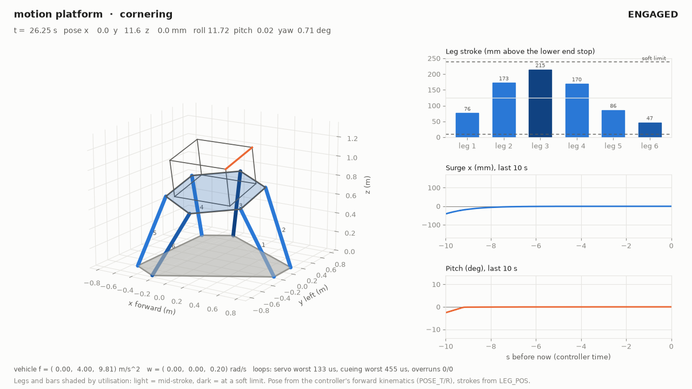

Video of the whole recorded session: [docs/media/platform_view.mp4](docs/media/platform_view.mp4) (72 s). It runs five scenarios, then braking with an E-stop.

An offline closed loop runs the C library on six vehicle scenarios and measures the cue the platform actually delivers. Tuning on it changed two parameters, added one (the tilt acceleration limit) and exposed six defects. Each was fixed and now has a regression test (SPEC §6.3a). Week 3 found four more, each fixed with a test (SPEC §6.4, §6.6):
- the servo overshot raw steps;
- a seized leg was pushed at full current;
- after RESET, the controller faulted again on a stale trip;
- the measured legs passed the soft limit by 10 µm.

## Results so far

| Check | Result |
|---|---|
| Unit tests (ztest on `native_sim`) | 61 of 61 pass, no warnings |
| Renode integration tests IT01–IT10 (firmware over CAN) | 10 of 10 pass (SPEC §9.2) |
| Ten minutes of cueing, all seven scenarios in turn (IT09) | 0 overruns in 604 481 servo and 302 240 cueing cycles; worst 119 µs of 1000 and 592 µs of 2000; 0 of 60 410 vehicle samples dropped |
| Washout gain over CAN (IT10) | GET/SET acknowledged; bad value and bad key rejected; at gain 0.25 the pitch holds −4.39° and the surge halves (40.9 mm) |
| Live host session over SocketCAN (demo) | 100 Hz stream at a mean 10.00 ms on the controller clock; no lost report frame in 3579 cycles; IT03 reproduced (81.9 mm, −8.80°) |
| Line coverage of `mcue` (gcovr) | 96.3 %, 100 % of functions (CI gate ≥ 90 %) |
| Leg tracking in the firmware, lane change (IT04) | 0.5 µm RMS, 5.5 µm peak (limit 1 mm / 3 mm) |
| E-stop while moving (IT06) | standstill 44 ms after the button, descent at most 0.0496 m/s |
| Seized leg during ENGAGING (IT08) | following-error fault on that leg 122 ms after it seized; the others descend |
| Heartbeat loss (IT07) | COMMS_LOST 201 ms after the last sample, washout to neutral, park |
| Loop timing in Renode (virtual time) | servo worst 127 µs of 1000, cueing worst 581 µs of 2000, zero overruns |
| CAN payloads vs `protocol/motion.dbc` | every frame type identical byte for byte (cantools vectors) |
| Servo, 10 mm step under the full load | 0 % overshoot, settled in 61 ms |
| IK, statics and workspace against the NumPy reference vectors | exact to 1e-12 m / 1e-6 N |
| FK round trip, 1000 random poses, cold start / warm start | ≤ 1e-9, worst case 6 / 3 iterations |
| Workspace property test: 10,000 random commands up to ~2× the workspace | no leg ever outside its soft limits; output always the command scaled towards neutral |
| C library vs NumPy on 1000 random poses | IK 2e-16 m, FK 3e-14, statics 1.3e-7 N, workspace scale identical |
| Tustin sections vs continuous prototypes at the pre-warped frequency | within 1e-9 (re and im), three frequencies, all section types |
| C washout vs an independent SciPy implementation, all six scenarios | ≤ 1.6e-11 on every output |
| P05: sustained 3 m/s² surge | translation back within 5 mm after 4.2 s (limit 6 s); pitch holds −8.79° for a −8.80° cue |
| P04: tilt-coordination rate | ≤ 3.000°/s in every scenario; acceleration ≤ 20°/s² |
| P03: leg soft limits in the closed loop, including a 3 g cue | never passed (closest +0.00015 mm, cue scaled down to 0.41) |
| Leg shaper: fixed targets / feasible moving targets | reached within about 2 ms of time-optimal without overshoot / followed exactly |

## Closed loop (week 2)

`tools/reference/closed_loop.py` runs washout → workspace limit → IK → leg shaping → FK at 500 Hz, through ctypes on the real C library. It compares the specific force the platform delivers, `Rᵀ(a + g)` at the platform centre, with the cue asked for. The full table is in [results/closed_loop.md](results/closed_loop.md).

| Scenario | Peak x/y/z (mm) | Peak roll/pitch/yaw (°) | Saturated | Closest to soft limit | Relative cue error |
|---|---|---|---|---|---|
| launch, 3 m/s² for 8 s | 82 / 0 / 0 | 0.0 / 8.8 / 0.0 | 0 % | 34.5 mm | 0.50 |
| braking, −7 m/s² | 153 / 0 / 0 | 0.0 / 8.9 / 0.0 | 0 % | 4.9 mm | 0.91 |
| lane change, ±3 m/s² at 0.33 Hz | 0 / 111 / 0 | 5.2 / 0.1 / 2.7 | 0 % | 44.6 mm | 1.38 |
| cornering, 4 m/s² for 6 s | 0 / 105 / 0 | 11.7 / 0.0 / 2.9 | 0 % | 0.5 mm | 0.58 |
| road bump, heave up to 3.7 m/s² | 0 / 0 / 70 | 0.0 / 0.9 / 0.0 | 0 % | 47.7 mm | 0.80 |
| excessive, 3 g on x/y/z | 153 / 164 / 97 | 17.1 / 12.3 / 17.8 | 58 % | 0.0 mm (never past) | — |

The lane change scores worse than not moving, and no tuning changes that. At 0.33 Hz the cue needs ±0.35 m of sway against ±0.21 m available, and the 3°/s rate limit allows only about ±1.4° of tilt (SPEC §6.3a).

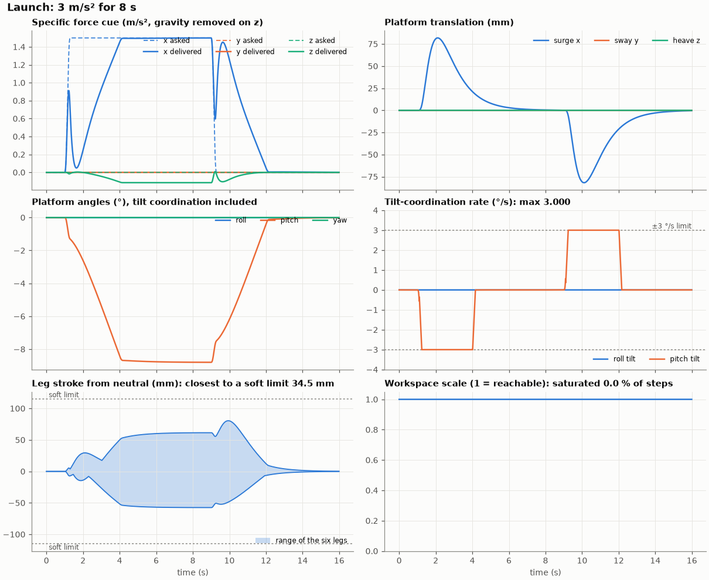
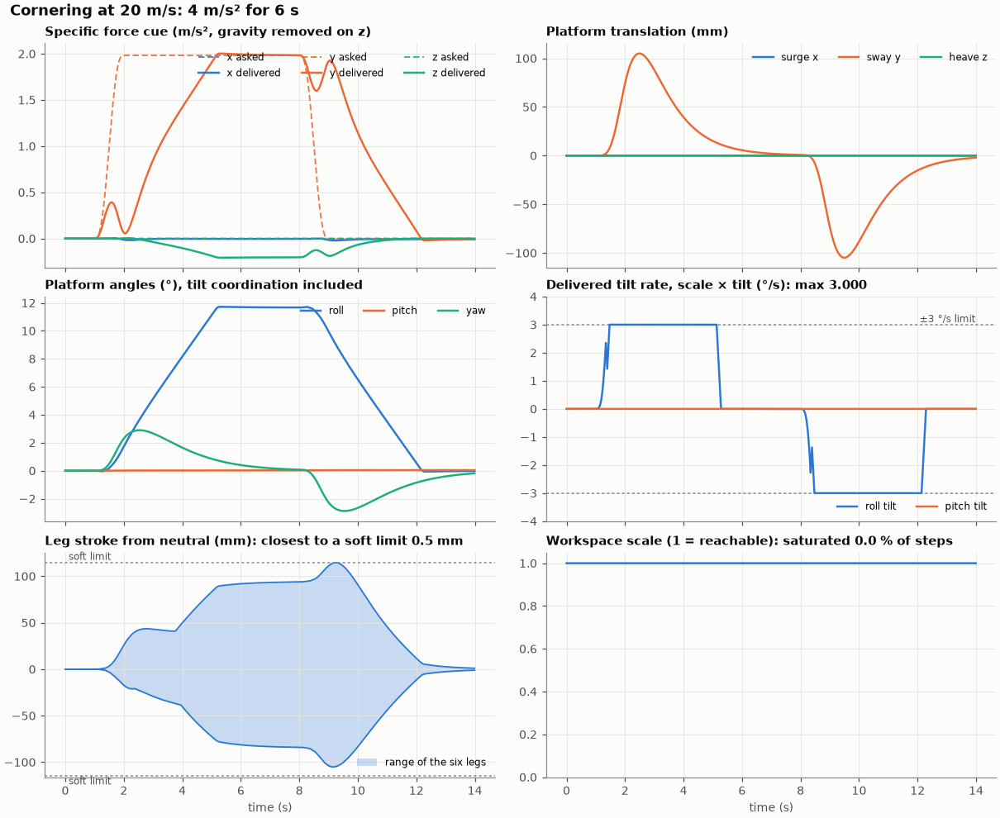
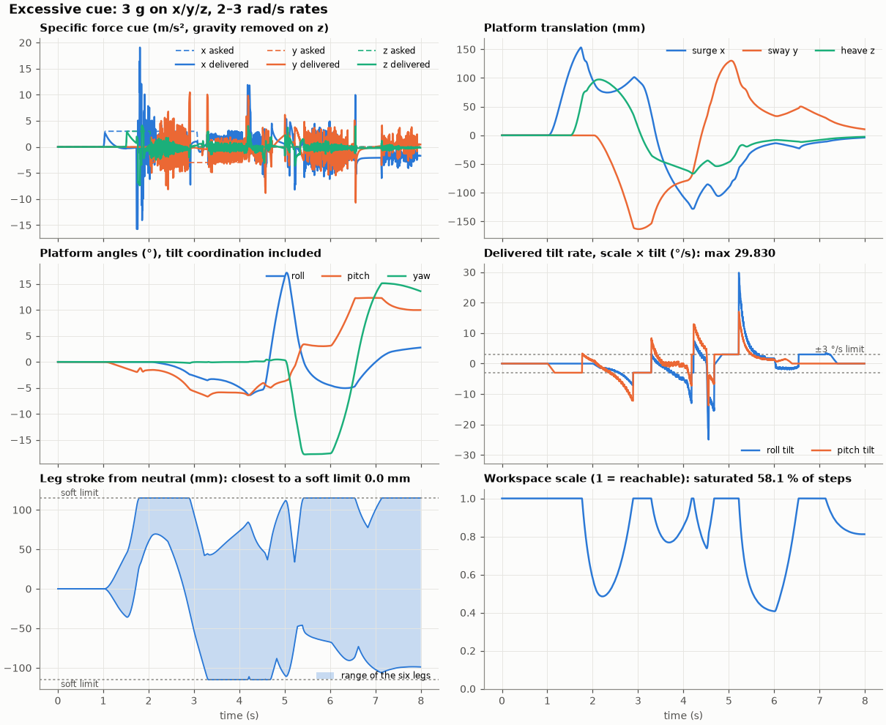

Plots for all six scenarios are in [results/plots/](results/plots/).

## Firmware (week 3)

```
 CAN 0x100/0x101 VEHICLE_F/W 100 Hz ──► cue thread 500 Hz ───────────────────────────────┐
 CAN 0x10F CMD ──► host thread ──► mcue/ctl: E-stop, heartbeat, faults, states,         │
                                   washout → workspace → IK → leg shaping, FK, statics   │ setpoints
 CAN 0x180-0x18F ◄── host thread 50 Hz: STATUS, POSE, LEG_POS/CUR, FAULT, TIMING          ▼
                                   servo thread 1 kHz: 6 × (P position → PI velocity → current
                                   + feed-forward), following-error / current monitors
                                                 │ act_write / act_read (HAL)
                                                 ▼
                                   act_sim.c: six ball-screw actuator models, gravity load
```

The controller core (`mcue/ctl`) is plain C. The firmware threads, the unit tests (against six actuator models) and the host build all run the same code.

**States:**
- OFF → HOMING → PARKED → ENGAGING (3 s S-curve) → ENGAGED (cueing) → PARKING → PARKED.
- Every fault and the E-stop stop the legs at the acceleration limit, stand still for 0.25 s, then descend to park at ≤ 0.05 m/s.

**Faults** (SPEC §6.6):
- following error > 5 mm for 50 ms;
- current saturated for 500 ms;
- a leg past its hard limit;
- loop overruns;
- an implausible encoder;
- the task watchdog.

**Renode tests.** For the tests, `sim/host_feed.py` stands in for the host inside Renode. It streams the vehicle on virtual time and records every frame the controller sends, so the tests are repeatable. `tests/robot/motionlib.py` decodes those frames with the DBC layouts and checks them against the requirements.

## Live session (week 4)

`scripts/demo.sh` runs the firmware in Renode with its CAN bus bridged to SocketCAN `vcan0`. `tools/host/demo_session.py` then drives it like an operator's host would:
- ENABLE, ENGAGE;
- launch, cornering, lane change, road bump and a 3 g cue;
- braking with the E-stop button pressed 2 s in (through the Renode monitor);
- RESET, which the controller refuses while the button is held and accepts after the descent.

The log is replayed into the plots and the video. Everything below is the controller's own output over CAN: FK pose, leg strokes, currents and timing.

| | |
|---|---|
| 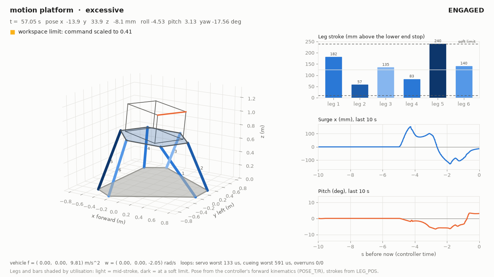 | 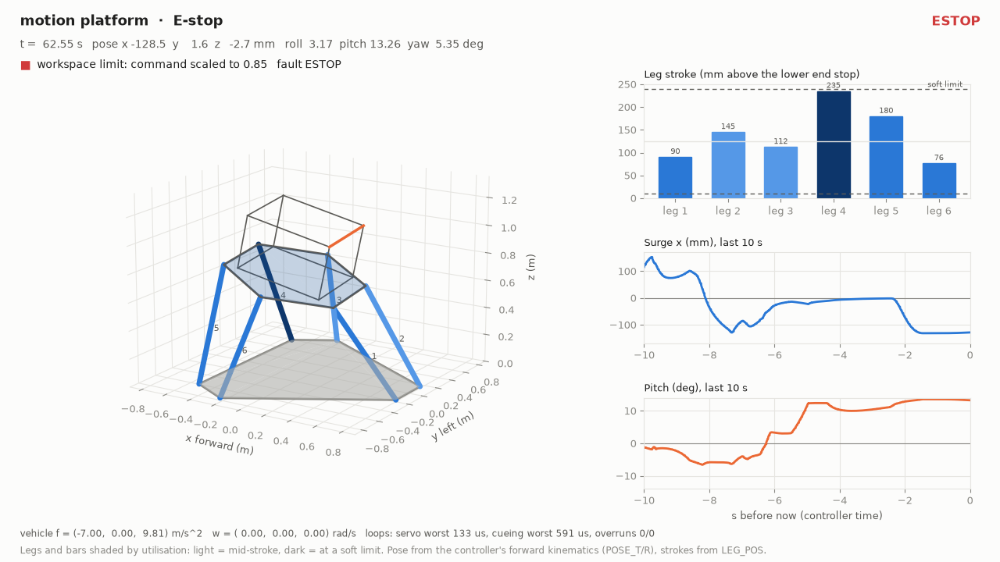 |
| 3 g cue: the command is scaled to 0.41; leg 5 reaches its soft limit and stops there. | E-stop during braking: the cue stops and the platform descends to park at 0.05 m/s (IT06 measures at most 0.0496 m/s). |

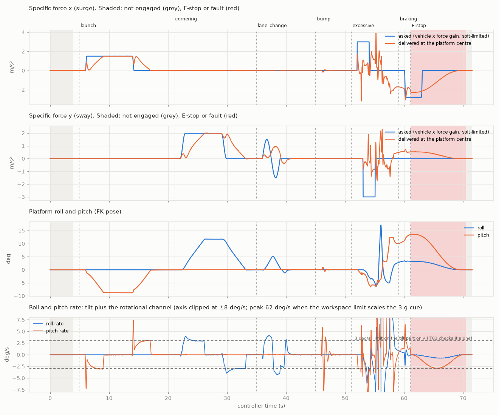
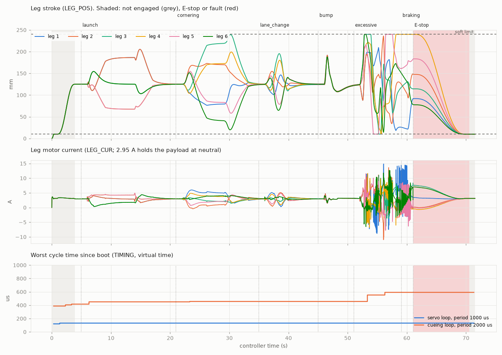

Session summary: [docs/session/summary.md](docs/session/summary.md). The log itself is in `docs/session/session.csv.gz`.

**How the host paces the stream.** On hardware the host sends at 100 Hz of wall time. The emulated controller runs slower than real time, so by default `motion_host.py` paces the stream on the controller's clock: each 50 Hz STATUS frame is 20 ms of controller time, and the clock is interpolated in between. The controller then gets 100 samples per second of its own time, and a pause in the emulation pauses the stream instead of tripping the heartbeat (SPEC §10).

## Tests

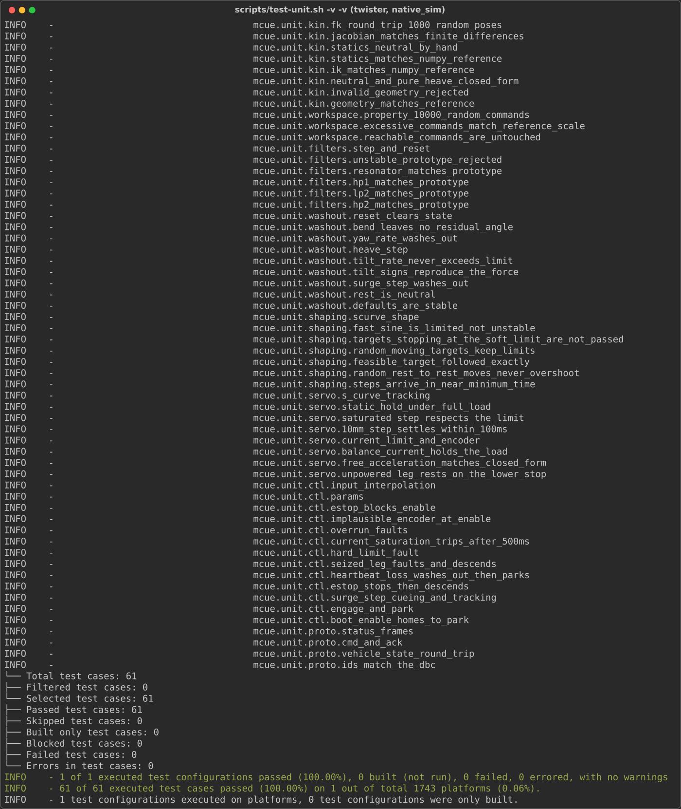
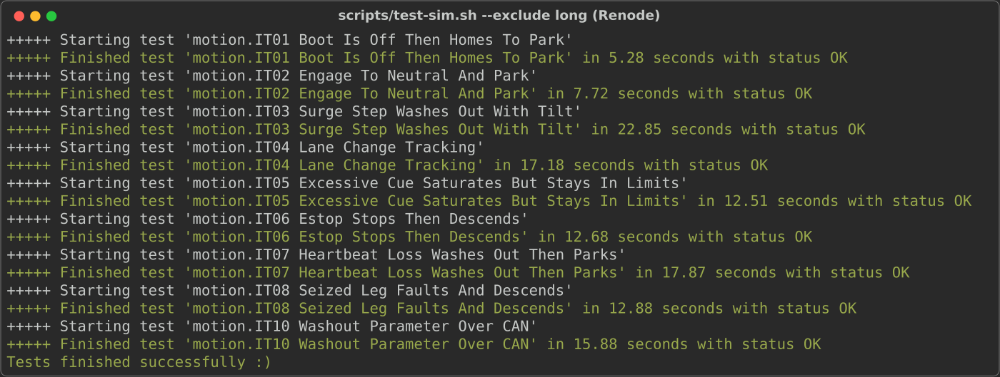
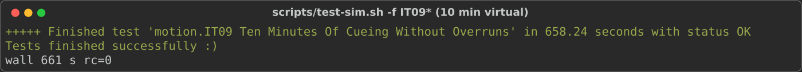

Requirement by requirement: [docs/traceability.md](docs/traceability.md) (two partial: F10 sends no leg speed, and F13's task watchdog is not fault-injected in S2).

## Reference geometry

The geometry lives in `config/platform.json`. It is the single source of truth for the C header and the test vectors.
- **Dimensions:** base radius 0.80 m, platform radius 0.50 m, neutral height 0.70 m, stroke 0.25 m.
- **Leg length:** 0.787 m at neutral, 27° from vertical.
- **Single-axis reach:** surge +0.26 / −0.21 m, sway ±0.21 m, heave ±0.13 m, roll ±14°, pitch +17 / −16°, yaw ±27°.
- **Load:** a 500 kg payload puts 919 N on each leg at neutral.

The 30° platform half-angle was chosen by comparing workspace and Jacobian conditioning (SPEC §3).

## Run it (WSL2 Ubuntu, same setup as the S1 trainer firmware)

```bash
bash scripts/test-unit.sh     # ztest unit tests on native_sim
bash scripts/crosscheck.sh    # headers current + C vs NumPy (kinematics) and SciPy (washout)
bash scripts/build.sh         # firmware for stm32h7_renode_reference_board
bash scripts/test-sim.sh --exclude long   # Robot Framework tests IT01-IT08, IT10 in Renode (about 2 min)
bash scripts/test-sim.sh --include long   # IT09: 10 minutes of virtual time (about 11 min)
bash scripts/test-unit.sh --coverage --coverage-tool gcovr   # with line coverage
sudo bash scripts/demo.sh     # live session over SocketCAN vcan0 -> docs/session, docs/media
python3 protocol/gen_vectors.py   # after changing protocol/motion.dbc
```

Firmware shell (UART): `motion status|legs|pose|params|fault|plant|timing|track|can|version`, `motion cmd enable|engage|park|reset`, `motion set|get <key> [value]`, `motion seize <leg> <0|1>`.

Host tools, with the firmware running in Renode on `sim/motion_live.resc` (bridged to `vcan0`):

```bash
cd tools/host
python3 motion_host.py play launch cornering --log session.csv   # ENABLE, ENGAGE, play, PARK
python3 motion_host.py get force_gain
python3 motion_host.py set force_gain 0.4                       # only in OFF or PARKED
python3 platform_view.py --live                                 # 3D window (WSLg or a desktop)
python3 platform_view.py --replay session.csv --frames-dir frames --video view.mp4
python3 session_plots.py session.csv --out plots
```

```bash
cd tools/reference
python3 closed_loop.py                     # all scenarios → results/closed_loop.md, results/plots/
python3 closed_loop.py --set force_gain=0.6 --no-plots   # try a parameter (prints only)
python3 tune.py                            # grid search of the washout parameters (~7 min)
python3 scenarios.py                       # list the scenarios
python3 scenarios.py --export              # write sim/data/*.csv for the Renode tests
python3 gen_headers.py                     # after changing config/platform.json
python3 geometry_check.py --compare 10 20 30 40
```

## Layout

```
config/platform.json    geometry, payload, limits, washout, actuator, servo, safety (single source of truth)
mcue/                   portable C library: include/mcue/*.h, src/*.c, generated platform_config.h
app/                    Zephyr firmware: motion threads, actuator HAL (simulation), CAN, host reports, shell
protocol/               motion.dbc (source of truth for the CAN layout) and the test-vector generator
sim/                    Renode board and machine scripts (motion_live.resc: SocketCAN bridge), host stand-in (host_feed.py), scenario CSVs
tests/unit/             ztest suites (linalg, kin, workspace, filters, washout, shaping, servo, ctl, proto)
tests/robot/            Robot Framework tests IT01-IT10 and the CAN log analysis (motionlib.py)
tools/reference/        NumPy/SciPy references, ctypes bindings, scenarios, closed loop, tuning, header generator
tools/host/             SocketCAN host (motion_host.py), 3D view, session plots, demo session
docs/                   traceability, recorded session (log, plots, summary), screenshots and video
results/                closed-loop table and plots (generated by closed_loop.py)
scripts/                build, test and cross-check helpers (bind-mount the repo in WSL: path has a space)
```
