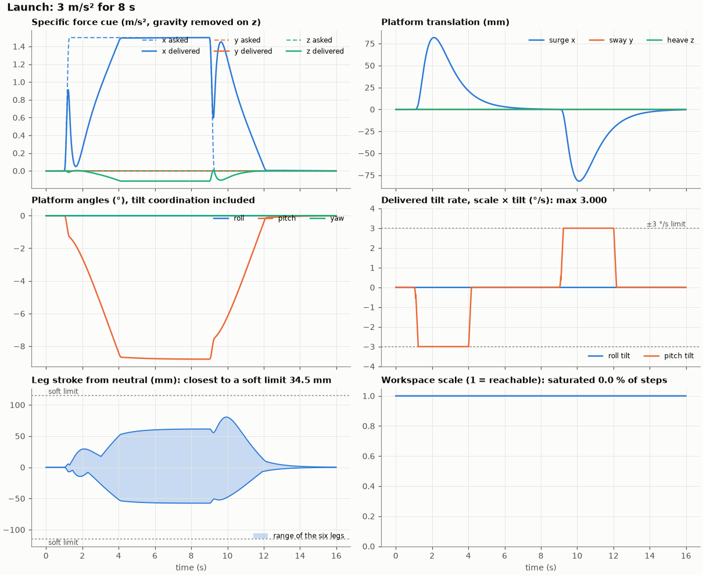
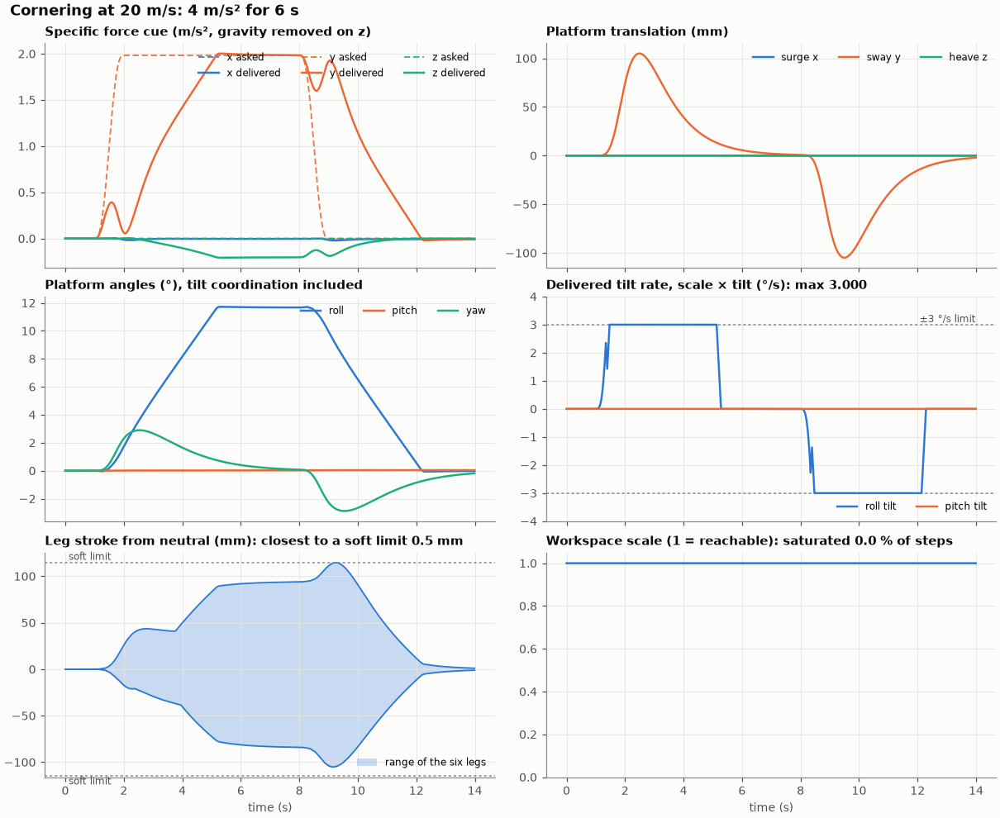
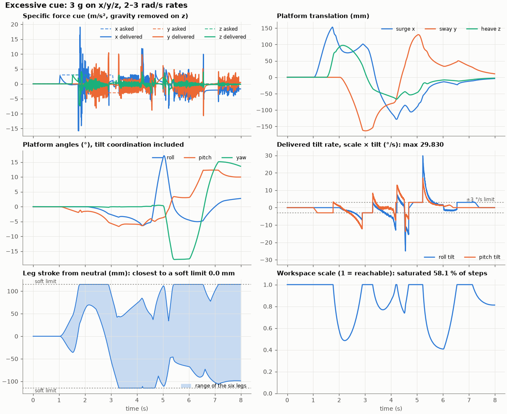
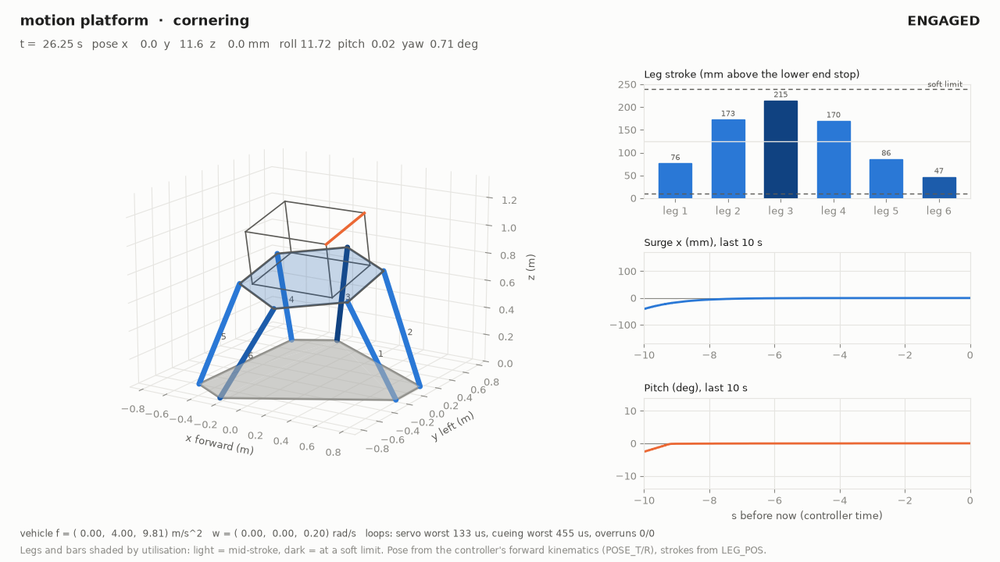
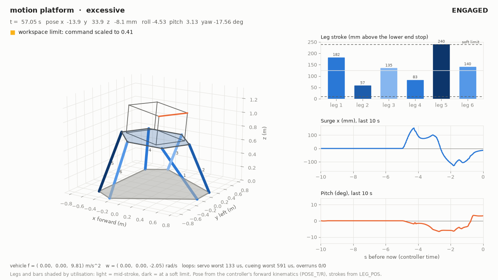
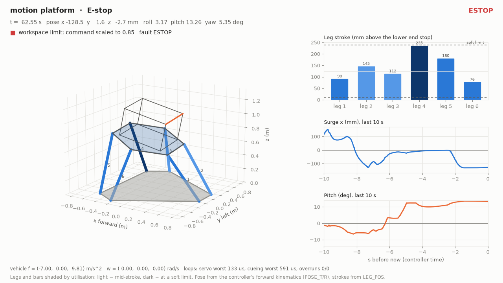
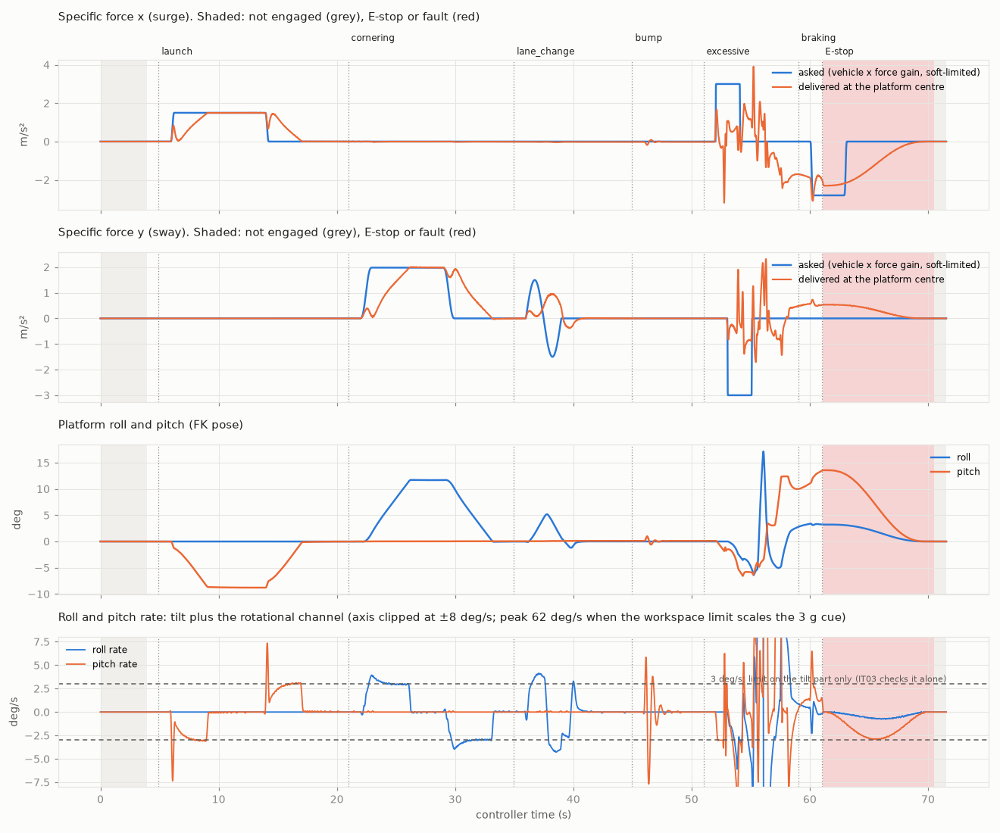
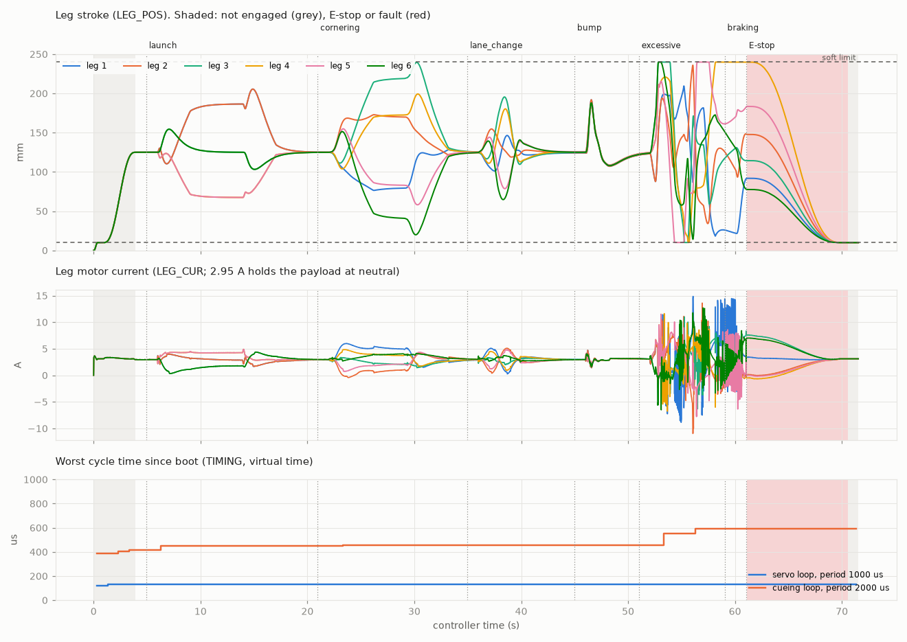

# Results

Every figure below names the run it comes from. Unless a row says otherwise, it is from the current code (firmware 0.4.0, see [CHANGELOG.md](../CHANGELOG.md)): unit tests and coverage through `scripts/test-unit.sh`, the cross-checks through `scripts/crosscheck.sh --n 1000`, the closed loop through `closed_loop.py --check`, and the Renode tests through `scripts/test-sim.sh`. Requirement by requirement: [traceability.md](traceability.md).

## All checks

| Check | Result | Source |
|---|---|---|
| Unit tests (ztest on `native_sim`) | 72 of 72 pass, no build warnings | twister, `tests/unit` |
| Line coverage of `mcue` (gcovr) | 96.3 % (987 of 1025 lines), 100 % of functions; CI fails below 90 % | `test-unit.sh --coverage` |
| Renode integration tests IT01–IT08, IT10 | 9 of 9 pass, 128 s wall | `test-sim.sh --exclude long` |
| Ten minutes of cueing, all seven scenarios (IT09) | 601 s virtual in 11 min 4 s wall: 0 overruns in 604 523 servo and 302 261 cueing cycles; worst 138 µs of 1000 and 600 µs of 2000; 0 of 60 410 vehicle samples dropped or stale; no STATUS gap; servo mean 116.5 µs, cueing mean 479.1 µs | `test-sim.sh --include long` |
| Loop timing in the short Renode tests | servo worst 138 µs of 1000, cueing worst 588 µs of 2000 (IT05, the 3 g cue), 0 overruns | TIMING frames of IT01–IT08, IT10 |
| E-stop while moving (IT06) | standstill 40 ms after the button (including the 30 ms debounce); descent at most 0.0456 m/s over 100 ms windows | IT06 |
| Seized leg during ENGAGING (IT08) | following-error fault on that leg 122 ms after it seized; the other legs descend at most 0.0458 m/s | IT08 |
| Heartbeat loss (IT07) | COMMS_LOST 213 ms after the last sample, washout to neutral, park, no latched fault | IT07 |
| Homing (IT01) | at most 0.0433 m/s; parked at 10.00 mm stroke | IT01 |
| Excessive 3 g cue (IT05) | SATURATED set, workspace scale down to 0.405, strokes 10.09–239.91 mm of 10–240 mm, no fault | IT05 |
| Surge step (IT03) | onset 81.9 mm, pitch −8.80°, FK pitch rate 3.10°/s (3.0 plus the 0.01° POSE_R resolution) | IT03 |
| Lane-change tracking (IT04) | 0.5 µm RMS, 5.6 µm peak over 10 500 servo samples (limit 1 mm / 3 mm) | IT04 |
| Washout gain over CAN (IT10) | GET/SET acknowledged; bad value and bad key rejected; at gain 0.25 the pitch holds −4.39° and the onset halves (40.9 mm) | IT10 |
| CAN payloads vs `protocol/motion.dbc` | every frame type identical byte for byte (cantools vectors) | unit `proto`, `gen_vectors.py --check` |
| Servo, 10 mm step under the full load | 0 % overshoot, settled to 2 % in 61 ms (down) / 63 ms (up) | unit `servo` |
| IK, statics and workspace against the NumPy reference vectors | exact to 1e-12 m / 1e-6 N | unit `kin`, `workspace` |
| FK round trip, 1000 random poses | ≤ 1e-9; worst case 6 iterations cold, 3 warm | unit `kin` |
| Workspace property test, 10 000 random commands up to about 2× the workspace | no leg outside its soft limits; output always the command scaled towards neutral (5000 needed scaling) | unit `workspace` |
| C library vs NumPy, 1000 random poses | IK 2.2e-16 m, FK 3.0e-14, statics 1.3e-7 N, workspace scale identical | `crosscheck.py` |
| C washout vs an independent SciPy implementation, six scenarios | ≤ 1.6e-11 on every output | `crosscheck.py` |
| Tustin sections vs continuous prototypes at the pre-warped frequency | within 1e-9 (re and im), three frequencies, all section types | unit `filters` |
| Leg shaper: fixed targets / feasible moving targets | within about 2 ms of time-optimal without overshoot / followed exactly | unit `shaping` |
| P05: sustained 3 m/s² surge | translation back within 5 mm after 4.2 s (limit 6 s); pitch holds −8.79° for a −8.80° cue | closed loop |
| P04: tilt rate | delivered tilt 3.000°/s in the five scenarios without saturation; 29.8°/s in the 3 g cue (workspace scale changing); the limiter's own state 3.000°/s everywhere | closed loop |
| P03: leg soft limits in the closed loop, including the 3 g cue | never passed (closest 0.00015 mm, cue scaled down to 0.41) | closed loop |
| Live host session over SocketCAN | 100 Hz stream at a mean 10.00 ms on the controller clock; no lost report frame in 3579 cycles; IT03 reproduced (81.9 mm, −8.80°). Recorded with firmware 0.3.0, before the 0.4.0 changes; not re-recorded | [session/summary.md](session/summary.md) |

## Loop timing: what the numbers mean

Loop times are execution times of each loop body on Renode's virtual clock (cycle counter at the start and end of the body), not timer-to-thread latency and not silicon timing. The servo figure includes the simulated plant (`act_write`: six actuator models, ten sub-steps each) and the cueing figure includes FK and the statics for the plant's gravity load; a real controller would not do that work.

IT09 (ten minutes, all seven scenarios) is the reference set: servo worst 138 µs, mean 116.5 µs; cueing worst 600 µs, mean 479.1 µs; zero overruns. The cueing worst case comes from the 3 g cue, where the workspace bisection (12 IK evaluations) runs every step. In the 0.3.0 IT09 run the servo loop was 119 µs worst and 104 µs mean: the servo step now runs outside its spinlock, so interrupts are served inside the measured window. The live host session in `session/summary.md` (133 µs / 591 µs) is from 0.3.0 too.

## Closed loop

`tools/reference/closed_loop.py` runs washout → workspace limit → IK → leg shaping → FK at 500 Hz through ctypes on the C library, without the servo. It compares the specific force the platform delivers, `Rᵀ(a + g)` at the platform centre, with the cue asked for. Full table: [results/closed_loop.md](../results/closed_loop.md).

| Scenario | Peak x/y/z (mm) | Peak roll/pitch/yaw (°) | Max tilt rate (°/s) | Saturated | Closest to soft limit | Relative cue error |
|---|---|---|---|---|---|---|
| launch, 3 m/s² for 8 s | 82 / 0 / 0 | 0.0 / 8.8 / 0.0 | 3.000 | 0 % | 34.5 mm | 0.50 |
| braking, −7 m/s² | 153 / 0 / 0 | 0.0 / 8.9 / 0.0 | 3.000 | 0 % | 4.9 mm | 0.91 |
| lane change, ±3 m/s² at 0.33 Hz | 0 / 111 / 0 | 5.2 / 0.1 / 2.7 | 3.000 | 0 % | 44.6 mm | 1.38 |
| cornering, 4 m/s² for 6 s | 0 / 105 / 0 | 11.7 / 0.0 / 2.9 | 3.000 | 0 % | 0.5 mm | 0.58 |
| road bump, heave up to 3.7 m/s² | 0 / 0 / 70 | 0.0 / 0.9 / 0.0 | 0.000 | 0 % | 47.7 mm | 0.80 |
| excessive, 3 g on x/y/z | 153 / 164 / 97 | 17.1 / 12.3 / 17.8 | 29.830 | 58 % | 0.0 mm (never past) | — |

The tilt rate is that of the delivered tilt, workspace scale × tilt angle. Under saturation the whole pose is scaled, tilt included, so the tilt moves with the scale (SPEC §6.3a). The lane change scores worse than not moving, and no tuning changes that: at 0.33 Hz the cue needs ±0.35 m of sway against ±0.21 m available, and the 3°/s rate limit allows only about ±1.4° of tilt.





Plots for all six scenarios are in [results/plots/](../results/plots/).

## Live session

`scripts/demo.sh` runs the firmware in Renode with its CAN bus bridged to SocketCAN `vcan0`. `tools/host/demo_session.py` drives it like an operator's host: ENABLE, ENGAGE; launch, cornering, lane change, road bump and a 3 g cue; braking with the E-stop pressed 2 s in (through the Renode monitor); RESET, refused while the button is held and accepted after the descent. Everything plotted is the controller's own output over CAN: FK pose, leg strokes, currents and timing. The recording is from firmware 0.3.0 (descent commanded at 0.05 m/s then, 0.045 m/s now).



| | |
|---|---|
|  |  |
| 3 g cue: the command is scaled to 0.41; leg 5 reaches its soft limit and stops there. | E-stop during braking: the cue stops and the platform descends to park. |




**How the host paces the stream.** On hardware the host sends at 100 Hz of wall time. The emulated controller runs slower than real time, so by default `motion_host.py` paces the stream on the controller's clock: each 50 Hz STATUS frame is 20 ms of controller time, interpolated in between. The controller then gets 100 samples per second of its own time, and a pause in the emulation pauses the stream instead of tripping the heartbeat.

Screenshots of the 0.3.0 test runs (61 unit tests at the time): [unit](media/tests_unit.png), [Renode](media/tests_sim.png), [IT09](media/tests_it09.png).

## Tools

Firmware shell (UART): `motion status|legs|pose|params|fault|plant|timing|track|can|version`, `motion cmd enable|engage|park|reset`, `motion set|get <key> [value]`, `motion seize <leg> <0|1>`.

Host tools, with the firmware running in Renode on `sim/motion_live.resc` (bridged to `vcan0`):

```bash
cd tools/host
python3 motion_host.py play launch cornering --log session.csv   # ENABLE, ENGAGE, play, PARK
python3 motion_host.py get force_gain
python3 motion_host.py set force_gain 0.4                       # only in OFF or PARKED
python3 platform_view.py --live                                 # 3D window (WSLg or a desktop)
python3 platform_view.py --replay session.csv --frames-dir frames --video view.mp4
python3 session_plots.py session.csv --out plots
```

Reference tools:

```bash
cd tools/reference
python3 closed_loop.py                     # all scenarios → results/closed_loop.md, results/plots/
python3 closed_loop.py --set force_gain=0.6 --no-plots   # try a parameter (prints only)
python3 tune.py                            # grid search of the washout parameters (several minutes)
python3 scenarios.py --export              # write sim/data/*.csv for the Renode tests
python3 gen_headers.py                     # after changing config/platform.json
python3 geometry_check.py --compare 10 20 30 40
```

After changing `protocol/motion.dbc`: `python3 protocol/gen_vectors.py` from the repository root.
